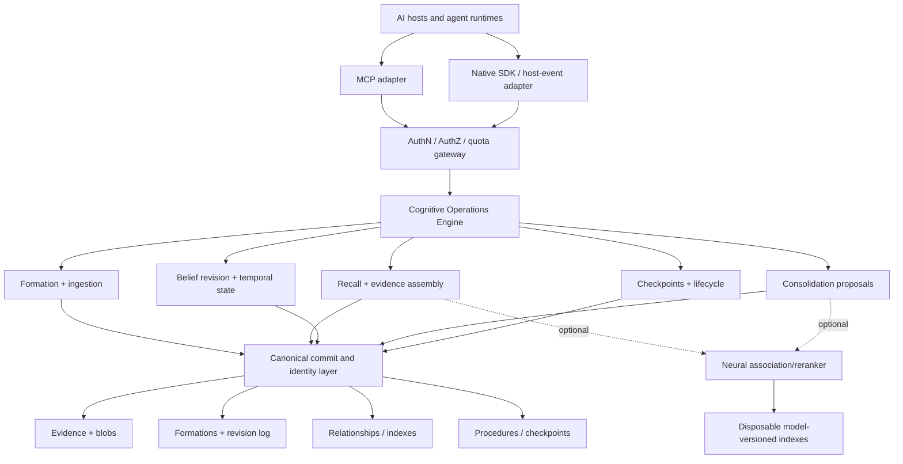

# 02 — System Architecture

**Version:** 0.1.0 | **Status:** Proposed

## Architectural layers

## Domain components

1. **Identity and commit service:** stable identifiers, idempotency, optimistic concurrency, atomic commit boundaries, versioned canonical facts.
2. **Evidence service:** immutable evidence records, provenance, digests, modality references, retention and privacy scopes.
3. **Formation service:** validated semantic formations, links to evidence, provenance and epistemic status.
4. **Belief service:** claims and revision chains, support/refute edges, contexts, applicability, as-of queries and supersession.
5. **Recall planner:** interprets cognitive need; authorizes candidates; blends exact, graph, temporal and optional associative retrieval; produces bounded evidence packets.
6. **Consolidator:** discovers pattern candidates and deduplication candidates, preserves lineage, stages changes for validation.
7. **Lifecycle service:** retention, archival, expiry, access revocation and erasure workflows, including derivative impact.
8. **Checkpoint service:** named resumable context with expiration, links to canonical evidence and known task state.
9. **Evaluation service:** offline corpora, counterfactual ranking comparisons, task outcomes, calibration and policy audits.
10. **Integration gateway:** protocol adapters, tenant/authentication boundaries, rate limits, observability.

## Canonical representation and indexes

Use append-oriented canonical records for observations and revisions. Relationships and projections are derived from canonical events and versioned. Neural vectors are generated asynchronously, carry `model_id`/`representation_version`, and can be discarded and rebuilt. Do not mistake the derived index for the evidence. A graph is a logical relationship view; it need not require a separate graph database in MVP.

### Initial physical deployment proposal

Single service process; one transactional persistence engine plus content-addressed evidence blobs; in-process or asynchronous deterministic index worker; optional embedding provider behind interface. This minimizes operational complexity and tests whether the semantic design holds before introducing distributed components.

Do not preselect a language or database as a fundamental project requirement. Select through an ADR after measuring atomic revision transactions, query patterns, schema evolution, backup/restore and operational burden.

## Main data paths

### Ingest

Host -> authorization -> normalize source evidence -> hash -> atomic commit evidence + formation reference -> enqueue index update -> report committed identifier and indexing status. Never claim a durable commit before storage acknowledges it. Idempotency key deduplicates retries, not distinct observations.

### Recall

Host -> authenticated cognitive request -> eligibility filter -> candidate generation (exact/temporal/semantic/associative) -> provenance overlap and contradiction checks -> calibrated relevance/risk ranking -> token/size budget assembly -> response with references, uncertainties and explanations. Every final output item is re-authorized.

### Revision

Actor proposes revision -> check authority and expected version -> validate evidence links -> append revision + derived relationships atomically -> previous belief remains queryable -> invalidate/rebuild affected projections.

### Consolidation

Scheduled or requested worker reads eligible evidence -> proposes candidate abstraction -> checks duplication and independence of evidence -> validates constraints -> publishes to review queue -> authorized verifier accepts, rejects or requests experiment. Rejections remain observable but are excluded from authoritative retrieval by default.

### Deletion

Authorized request -> identify direct and derivative lineage -> mark unavailable to all subsequent recall -> erase authoritative payload, projections, replicas and caches according to policy -> publish verifiable completion/exception report. Prevent reintroduction from stale job queues or later index rebuilds via tombstone/erasure constraints. Define explicit limits for offline backups and external exports.

## Concurrency and consistency

- Strong transactions for evidence identities, revision commits, permissions, and deletion fences.
- Optimistic expected-version checks on simultaneous belief edits; conflicts require merge/review rather than last-writer-wins.
- Derived index updates may be eventually consistent with explicit `indexed_through_revision` watermarks.
- Query modes: `strong_canonical` (slower, authoritative) or `indexed_fast` (may lag, reports watermark).
- Duplicate source observations must be differentiated from repeated assertions and inferred copies.

## Failure handling

| Failure | Response |
|---|---|
| Crash during ingest | Transaction roll-back or recover committed record; retry idempotently |
| Index behind canonical state | Signal freshness watermark; offer canonical fallback |
| Model/embedding provider unavailable | Return exact/structured recall; degraded-mode indicator |
| Conflicting revisions | Version conflict with candidate IDs; no destructive overwrite |
| Unauthorized relationship traversal | Stop edge expansion before fetching protected node |
| Consolidation worker fails | No authoritative promotion; resume from durable job state |
| Partial deletion failure | Keep recall denied; surface incomplete erasure status and retry |

## Deployment evolution

**Stage A:** embedded/single-node service + local stdio MCP.  
**Stage B:** separate gateway + HTTP MCP + workers; single canonical store.  
**Stage C:** horizontal query services, replicated evidence and distributed index build; retain clear source of truth.  
**Stage D:** multi-region optional, only with proven needs and explicit consistency contract.
