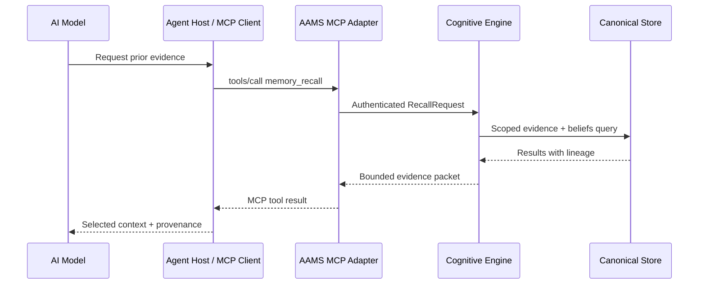

# 04 — Model Connectivity, MCP and APIs

**Version:** 0.1.0 | **Status:** Proposed

## Connection model

The **host application**, not an isolated model weight tensor, is the MCP client. It offers tools/resources to the model, mediates user permissions, captures permitted task events, and sends those events to AAMS. MCP does not provide universal access to all prompts, model activations or hidden reasoning. Automatic capture, event streaming and proactive injection require explicit host/runtime integration.



## MCP standards baseline

**Target:** MCP specification release **2026-07-28**, subject to verified SDK/client support. This release introduced a stateless request model, removed protocol-level sessions and the prior initialization handshake, and removed HTTP GET streaming in Streamable HTTP. The HTTP transport uses POST requests, request-scoped responses/streams and required protocol-version metadata/headers. **Do not implement examples from 2025 MCP as if wire-compatible with 2026 without negotiation and conformance tests.**

Official references:

- https://modelcontextprotocol.io/specification/2026-07-28
- https://github.com/modelcontextprotocol/modelcontextprotocol/blob/main/docs/specification/2026-07-28/basic/index.mdx
- https://github.com/modelcontextprotocol/modelcontextprotocol/blob/main/docs/specification/2026-07-28/basic/transports/streamable-http.mdx
- https://github.com/modelcontextprotocol/modelcontextprotocol/blob/main/docs/specification/2026-07-28/server/tools.mdx
- https://github.com/modelcontextprotocol/modelcontextprotocol/blob/main/docs/specification/2026-07-28/changelog.mdx

MCP tools expose application-defined domain operations; MCP resources expose authorized read-only memory views. AAMS does not claim these tool names are built-in MCP standards.

## Initial MCP tools

| Tool | Input contract | Response | Mutation |
|---|---|---|---|
| `memory_form` | source payload/ref, source type, context, scope, idempotency key | immutable formation/evidence IDs, commit revision, indexing status | Yes |
| `memory_recall` | goal, filters, kinds, budget, freshness, contradiction setting | citations/formation IDs, ranked claims, uncertainties, watermark | No |
| `memory_explain` | formation/belief ID, max depth, required provenance | evidence graph and revision rationale | No |
| `memory_revise` | belief ID, expected revision, proposed state, evidence refs, rationale | revision ID/conflict | Yes |
| `memory_checkpoint` | task, state, references, expiry, idempotency key | checkpoint ID and revision | Yes |
| `memory_reflect` | subject, objectives, scope, review policy | candidate hypotheses/generalizations, never authoritative by default | Stages candidates |
| `memory_associate` | formation IDs/query, relation constraints | related formations with reason and scope | No |
| `memory_forget` | target IDs/scope, mode, authority, confirmation token | deletion job and verifiable status | Yes; privileged |

MVP tools: `memory_form`, `memory_recall`, `memory_explain`, `memory_revise`. Add remaining operations according to roadmap gates.

## MCP resources (proposal)

- `aams://formations/{id}` — authorized immutable formation view.
- `aams://beliefs/{id}/revisions/{revision}` — as-of belief revision.
- `aams://evidence/{id}/metadata` — source metadata, not necessarily sensitive payload.
- `aams://checkpoints/{id}` — authorized task snapshot.
- `aams://health/capabilities` — supported core, tools and protocol versions.

Resource URI syntax is project-defined; content is always filtered through the same authorization boundary as tool responses.

## Native cognitive API

Expose operation semantics independent of MCP: `form()`, `recall()`, `explain()`, `revise()`, `checkpoint()`, plus **authorized host events** (`task_started`, `tool_result_observed`, `decision_made`, `outcome_measured`, `task_completed`). Host events are opt-in and bounded by consent and privacy policy. A native batch API can improve throughput and support stream processing without burdening the MCP tool-call loop.

## Recall request schema sketch

```json
{
  "goal": "diagnose latency regression",
  "memory_kinds": ["experiential", "causal", "procedural"],
  "scope": "domain:performance",
  "include_contradictions": true,
  "require_provenance": true,
  "consistency": "strong_canonical",
  "max_items": 12,
  "token_budget": 3000
}
```

Response includes `items[]` with `formation_id`, `claim`, `evidence_ids`, `provenance`, `epistemic_state`, `applicability`, `contradictions`, `ranking_reason`, and `freshness_watermark`; `truncation` and `degraded_mode` flags are mandatory when applicable.

## Errors and retries

Define stable domain errors: `INVALID_SCHEMA`, `NOT_AUTHORIZED`, `NOT_FOUND_OR_FORBIDDEN`, `VERSION_CONFLICT`, `EVIDENCE_UNAVAILABLE`, `INDEX_STALE`, `RATE_LIMITED`, `CONSENT_REQUIRED`, `ERASURE_PENDING`, `UNSUPPORTED_PROTOCOL_VERSION`. Retries on mutations require idempotency keys. Never disclose the existence of forbidden memories through distinguishable error messages.

## Protocol security

For Streamable HTTP, validate Origin, authenticate requests, enforce scoped authorization, rate limit operations and use TLS for remote deployment. The 2026 release introduces required request metadata and header semantics; use the official spec and conformance suite to avoid implementing obsolete routes and sessions. For stdio, use host-provided process credentials and avoid sending secrets in ordinary tool payloads. Privileged erase/promotion operations must require separate authority and explicit confirmation paths.

## Compatibility matrix (to verify in M01)

| Client family | Target | Requirement |
|---|---|---|
| 2026-07-28 MCP clients | Native | Full protocol conformance |
| Older 2025 MCP clients | Optional compatibility adapter | Separate negotiated behavior and test suite |
| Native host adapters | Versioned SDK/API | Identical authorization and semantics |
| Model without host tools | Unsupported direct integration | Requires host or application integration |
