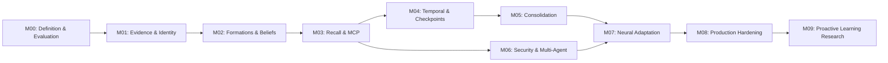

# 06 — Development Roadmap

**Version:** 0.1.0 | **Status:** Planned. All dates and effort estimates are intentionally uncommitted until sizing.**

## Dependency graph

## Milestone register

| Milestone | Purpose | Dependencies | Deliverables | Exit gate |
|---|---|---|---|---|
| M00 | Formalize invariants, test corpus and ADRs | — | Architecture review, goldens, research register, backlog | Acceptance tests specified; no unsupported claims |
| M01 | Commit durable evidence | M00 | Evidence CRUD/read, identity, hashes, transactions, backup/recovery | Atomic and idempotent ingest; crash tests pass |
| M02 | Formations and belief state | M01 | Typed schema, provenance edges, versioned revisions, policy evaluator | Reconstruct any belief state without changing evidence |
| M03 | Recall and MCP prototype | M02 | Exact+structured recall, ranked packet, MCP tools/resources, conformance | Two compatible host clients can form/recall/explain securely |
| M04 | Temporal queries and task continuity | M03 | As-of queries, checkpoints, restored task sample | As-of truth and checkpoint replay tests pass |
| M05 | Governed consolidation | M04 | Proposal workflow, duplicate lineage, contradiction tests | No generated hypothesis promoted without authorization |
| M06 | Multi-agent security and deletion | M03/M04 | Private/domain/shared scopes, promotion, erasure, audits | Isolation, deletion and rebuild tests pass |
| M07 | Adaptive retrieval research | M05/M06 | Optional embeddings/reranking, utility feedback, A/B | Better task outcome or quality/cost tradeoff vs baseline |
| M08 | Production readiness | M07 | CI, load/restore, observability, upgrade docs, release packages | SLOs defined and met; security gate signed off |
| M09 | Autonomous cognition research | M08 | Proactive recall experiments, knowledge-gap proposals, optional memory-weight pathway | Measurable benefit, bounded risk and governance review |

## Bounded work packages / implementation cards

### M00 — Definition and measurement

- **AAMS-001** Freeze baseline terminology, memory invariants, non-goals and requirements. *Acceptance:* reviewed ADR set and traceability map.
- **AAMS-002** Produce adversarial and normal synthetic memory corpus (contradictions, stale claims, copied evidence). *Acceptance:* versioned fixtures and expected answers.
- **AAMS-003** Define decision-quality and retrieval evaluation harness. *Acceptance:* reproducible no-memory vs memory baseline.
- **AAMS-004** Select initial runtime/storage after measured spike. *Acceptance:* ADR comparing atomicity, operations, maintainability and performance.

### M01 — Durable evidence

- **AAMS-005** Implement evidence record, digest, content reference and scope. *Acceptance:* integrity and source lineage tests.
- **AAMS-006** Implement atomic commit, stable IDs, idempotency and crash recovery. *Acceptance:* repeated retry and kill-point tests.
- **AAMS-007** Implement backup/restore and migration framework. *Acceptance:* restored hashes and schema compatibility verified.

### M02 — Semantic and epistemic core

- **AAMS-008** Implement formation schemas and linked evidence validation. *Acceptance:* malformed/unreferenced formation rejected.
- **AAMS-009** Implement belief revision chain with expected-version checks. *Acceptance:* concurrent update collision handled without loss.
- **AAMS-010** Implement relationship graph as logical projection and provenance lineage. *Acceptance:* correct scope-filtered traversal.
- **AAMS-011** Implement authorization policies and audit boundary for each operation. *Acceptance:* unauthorized operations denied.

### M03 — Retrieval and interoperability

- **AAMS-012** Implement exact/temporal/relationship candidate retrieval. *Acceptance:* goldens for exact and related evidence.
- **AAMS-013** Implement relevance packet builder with budget, uncertainty and contradiction references. *Acceptance:* stable schema and no invisible truncation.
- **AAMS-014** Implement MCP protocol adapter and four MVP tools. *Acceptance:* target spec conformance and tested client flows.
- **AAMS-015** Implement native SDK entry points and transport-agnostic domain service tests. *Acceptance:* outputs equivalent to MCP paths.

### M04 — Continuity

- **AAMS-016** Implement as-of and validity-interval queries. *Acceptance:* distinguish contemporary from retrospective truth.
- **AAMS-017** Implement cognitive checkpointing with task state and explicit expirations. *Acceptance:* independent model/agent reconstructs task state.

### M05 — Learning proposals

- **AAMS-018** Implement duplicate and copied-source detection. *Acceptance:* ten derived copies do not count as ten independent sources.
- **AAMS-019** Implement candidate consolidation and review workflow. *Acceptance:* reject/approve with lineage and no unauthorized promotion.
- **AAMS-020** Implement decision episodes and outcome feedback. *Acceptance:* hypotheses vs measured outcomes remain distinguishable.

### M06 — Sharing and governance

- **AAMS-021** Implement private/domain/collective scopes and controlled promotion. *Acceptance:* cross-scope authorization tests.
- **AAMS-022** Implement erasure traversal, tombstones and replica/index rebuild protection. *Acceptance:* no deleted content returns post-restore.
- **AAMS-023** Security red-team and policy verification. *Acceptance:* defined threat corpus and audit checkpoints pass.

### M07 — Adaptive association

- **AAMS-024** Add replaceable embedding/reranking plugin and versioned indexes. *Acceptance:* rebuild and fallback without data loss.
- **AAMS-025** Implement ranking feedback and experiment assignment. *Acceptance:* reproducible A/B with task outcomes.
- **AAMS-026** Evaluate consolidation quality and benefit. *Acceptance:* no regression in factual fidelity or calibration.

### M08–M09 — Shipping and research

- **AAMS-027** Profile throughput, latency, storage growth, token savings. *Acceptance:* published results and baseline comparison.
- **AAMS-028** Package service, deployment profiles, migration procedures and incident runbooks. *Acceptance:* restore drill and installation tests.
- **AAMS-029** Evaluate proactive recall with per-task interruption budget. *Acceptance:* improvement with safe opt-out and no permission bypass.
- **AAMS-030** Evaluate knowledge-gap and informative-experiment proposals. *Acceptance:* expert validation and controlled outcome gain.

## Work sequencing policy

Work one bounded card at a time per dependency chain. Merge only after passing tests, security checks and an independent review of evidence and claims. Recheck head state and downstream dependencies after each merge. Record blocked cards and reasons instead of bypassing gates. Parallelize only work that shares stable interfaces.

## MVP demo acceptance scenario

1. Agent A submits an observation and its evidence with scope and idempotency key.
2. AAMS commits canonical evidence plus formation and returns IDs.
3. Agent B requests related memory via MCP and sees provenance and uncertainty.
4. A contradictory report creates a contested belief; the original observation remains immutable.
5. A new authorized revision resolves the belief with full historical replay.
6. A forbidden agent cannot access either root data or derived/associated data.
7. Forced process restart and index rebuild preserve the committed truth and do not leak denied memories.
